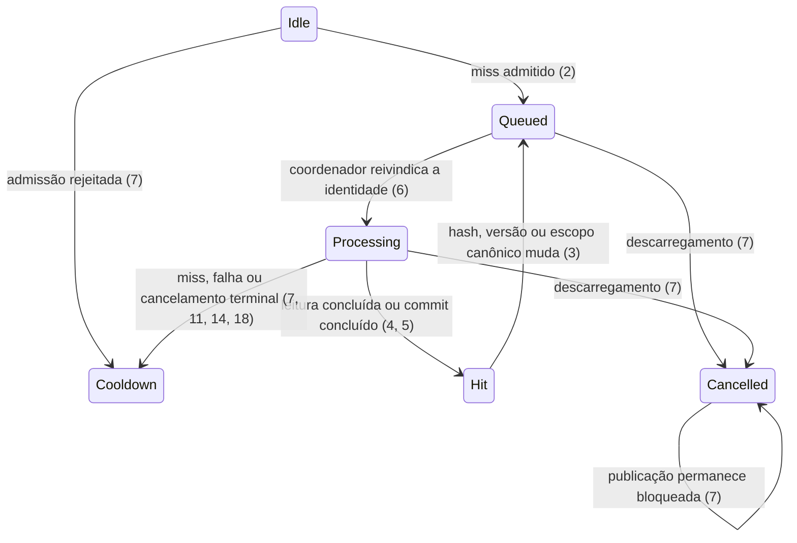

# Issue 258 DB-4 Action, Item, and Trait Async Persistence

> Build this with **tlc-implement**.
> Every criterion below becomes a check with a proof, referenced by its number. Nothing under
> `Unresolved` gets settled while building.

## Intent

Action, item, and trait detail paths still call synchronous Entity Framework and SQLite helpers after cache misses and while prefetch work is running. Those calls can hold game-facing work behind disk access and contribute to the frame-time spikes reported in Issue 258. The current DB-4 inventory contains 42 syntactic findings: 24 belong to the persistence helpers/operations, 8 are startup preloads deferred to DB-8, and 10 are non-DB synchronization or completed-task access that must not be refactored as DB-4 work.

When this task ships, visible `ActionDetail` and `ItemDetail` processing remains cache-first and never waits for SQLite. Missing canonical rows are resolved and persisted through the existing bounded `PersistenceCoordinator`, and the existing Action, Trait, and Item prefetch loops retain their present cadence while doing database work asynchronously. Existing schemas, canonical identities, translation behavior, display modes, and native UI ownership remain unchanged.

23 criteria in 5 slices · 0 one-way doors · 0 open

## Criteria

### Canonical persistence

1. Dado que o cache canônico contém uma linha compatível de Action, Trait ou Item, quando o runtime consulta a tradução, então recebe uma cópia gerenciada do cache sem abrir contexto de banco nem admitir trabalho no `PersistenceCoordinator`.
2. Dado que o cache canônico não contém uma linha compatível, quando o runtime solicita a leitura, então admite no máximo uma operação assíncrona por identidade canônica e devolve o controle antes de a consulta SQLite terminar.
3. Sempre, a identidade e a seleção canônicas preservam os IDs de Action, Trait e Item, idioma de origem normalizado, idioma de destino, `TranslationEngine`, `SourceContentHash`, `GameVersion`, escopo de reutilização, completude e a ordem atual de fallback e promoção histórica.
4. Quando uma leitura assíncrona encontra uma linha, então o cache é publicado somente depois da conclusão bem-sucedida da consulta; quando não encontra, nenhum valor sintético é publicado como tradução.
5. Quando uma gravação não altera os campos persistidos segundo a semântica atual do domínio, então nenhum `UPDATE` é emitido; quando altera ou insere, o cache é publicado somente depois de `SaveChangesAsync` concluir a transação.
6. Dado que a mesma identidade está enfileirada, em processamento ou reivindicada, quando outro produtor solicita o mesmo trabalho, então ele compartilha a conclusão existente em vez de iniciar outra consulta, tradução ou gravação.
7. Se a fila limitada rejeita uma admissão, uma operação é cancelada ou o plugin inicia descarregamento, então nenhum I/O síncrono é executado como fallback e nenhuma conclusão obsoleta publica dados no cache.

### Prefetch de Action e Trait

8. Enquanto o prefetch de Action está habilitado, no máximo 6 Actions são capturadas a cada intervalo existente de 2 segundos e o trabalho de persistência usa prioridade `Background`.
9. Enquanto o prefetch de Trait está habilitado, no máximo 6 Traits são capturadas a cada intervalo existente de 2 segundos e o trabalho de persistência usa prioridade `Background`.
10. Sempre, Action e Trait preservam o acoplamento atual de captura, as chaves canônicas, os campos de texto e a reutilização do `QueuedTranslationBroker`; nenhum ponteiro nativo, `AtkValue`, nó de addon ou leitura Lumina é acessado fora da Framework thread.
11. Se tradução, leitura ou gravação de Action ou Trait falha ou retorna sem tradução utilizável, então o texto original continua visível, a identidade alcança um estado terminal limitado e o próximo frame não reinicia o mesmo trabalho.

### Prefetch de Item

12. Enquanto o prefetch de Item está habilitado, no máximo 10 Items são capturados a cada intervalo existente de 2 segundos e o trabalho de persistência usa prioridade `Background`.
13. Sempre, Item preserva as identidades e normalizações atuais de `Item`, `EventItem`, `DeepDungeonItem`, HQ e fontes de inventário, além dos campos canônicos e da reutilização do `QueuedTranslationBroker`.
14. Se tradução, leitura ou gravação de Item falha ou retorna sem tradução utilizável, então o texto original continua visível, a identidade alcança um estado terminal limitado e o próximo frame não reinicia o mesmo trabalho.

### Tooltip estruturado visível

15. Dado um hit no cache, quando `ActionDetail` ou `ItemDetail` é processado, então a tradução existente é aplicada no mesmo passe com os comportamentos atuais de overlay, native e swap inalterados.
16. Dado um miss no cache, quando um Action, Trait ou Item visível é processado, então o runtime mantém o texto original naquele passe, agenda a leitura com prioridade `Interactive` e usa o cooldown existente de 30 segundos para impedir nova admissão a cada frame.
17. Quando a leitura, tradução e persistência em background terminam, então somente dados gerenciados são publicados e o próximo passe seguro da Framework thread pode aplicar a tradução; nenhum callback de worker escreve em addon, `AtkValue` ou nó nativo.
18. Se o resultado externo contiver erro, vazio ou payload sem tradução utilizável, então essa mensagem não é mostrada como tradução nem persistida como tradução, e o runtime mantém o original com logs resumidos, sem spam por item ou por frame.
19. Enquanto uma superfície ou modalidade de tradução estiver desabilitada pela configuração existente, o DB-4 não a captura, não a modifica e não restaura estado nativo que não tenha alterado.

### Compatibilidade, validação e entrega

20. Sempre, tabelas, colunas, migrações, arquivos de banco, chaves canônicas e compatibilidade com linhas existentes permanecem inalterados; APIs síncronas legadas podem permanecer apenas para testes, ferramentas ou setup, mas nenhum chamador de runtime migrado pode usá-las.
21. O relatório de auditoria distingue I/O DB-4 real de preloads de startup destinados ao DB-8 e de falsos positivos não relacionados a banco, sem exigir mudanças em `AsyncSerialActionPump`, nos waits de semaphore de `ActionItemDetailUiRuntime` ou no acesso a task concluída de `TooltipHandler`.
22. Quando a implementação é validada, então testes SQLite reais cobrem hit, miss, promoção histórica, supressão de update, publicação pós-commit, coalescência, rejeição, cancelamento e descarregamento; build, testes unitários, Mock/DalaMock aplicável e auditoria terminam sem erro.
23. Quando o PR estiver pronto para teste, então a branch `issue-258-05-action-item-trait` está publicada, o PR aponta para `v4-series`, e o usuário recebe o caminho, commit e SHA-256 da DLL Debug exata; merge e qualquer release permanecem bloqueados até pedidos expressos separados, e a release DB-4 também depende da integração e teste do UI-A.

## States

## Out of scope

- Implementar UI-A, comando global, botão HUD, glow, posição ou restauração global - esse trabalho permanece na branch `issue-258-04-translation-toggle` e é apenas dependência da release conjunta.
- Migrar `TooltipHandler` e o DB-first genérico de GameWindow - pertencem ao DB-5; os acessos `.Result` atuais ocorrem somente após confirmação de conclusão da task.
- Migrar preloads de startup de `ActionTooltipCacheManager`, `ItemTooltipCacheManager`, `TraitCacheManager` ou `TooltipTextCacheManager` - pertencem ao DB-8 junto do ciclo de vida assíncrono.
- Alterar `AsyncSerialActionPump` ou os waits de `TranslationOverlay.Semaphore` - são sincronização não DB e foram classificados pelo nome do arquivo, não pelo comportamento.
- Remover todas as APIs síncronas de persistência - a remoção residual e a fiscalização final pertencem ao DB-9.
- Alterar schema, migrations, formato de save, tradução, cache de falhas conhecidas, política de providers ou semântica visual.
- Merge, versionamento, tag, GitHub release, manifesto D17, candidate ou canary.

## Observable

| Surface | Decision | Landing |
| --- | --- | --- |
| `ActionDetail` | hit de Action/Trait | 15 |
| `ActionDetail` | miss/loading de Action/Trait | 16, 17 |
| `ActionDetail` | erro ou resultado vazio | 18 |
| `ItemDetail` | hit de Item | 15 |
| `ItemDetail` | miss/loading de Item | 16, 17 |
| `ItemDetail` | erro ou resultado vazio | 18 |
| prefetch de Action | cadência e limite | 8 |
| prefetch de Trait | cadência e limite | 9 |
| prefetch de Item | cadência e limite | 12 |
| superfícies desabilitadas | nenhuma mutação | 19 |
| novo controle visível | n/a - UI-A é tarefa separada |

## Swept

- validation: 3, 10, 13, 20
- failure modes: 7, 11, 14, 18
- idempotency and retry: 5, 6, 16
- authorization: n/a - não há endpoint, conta ou mudança de permissão
- concurrency and ordering: 2, 4, 5, 6, 7, 17
- data lifecycle: 4, 5, 7, 20
- external-dependency failure: 11, 14, 18
- state transitions: 6, 7, 16, 17
- observability: 21, 22, 23

## Impact

| Front | What changes |
|---|---|
| domain | novo termo interno: `ActionItemTooltipPersistenceWriter` - adaptador de vida útil do domínio que agenda leituras e gravações de Action, Trait e Item no coordenador compartilhado |
| runtime callers | `ActionDetailPrefetchRuntime`, `TraitDetailPrefetchRuntime`, `ItemDetailPrefetchRuntime` e `ActionItemDetailUiRuntime` deixam de chamar fallback SQLite síncrono |
| persistence policy | `ActionTooltipPersistenceHelper`, `TraitPersistenceHelper` e `ItemTooltipPersistenceHelper` ganham caminho EF assíncrono que reutiliza exatamente a política canônica existente |
| cache | `ActionTooltipCacheManager`, `TraitCacheManager` e `ItemTooltipCacheManager` continuam sendo projeções em memória; publicação passa a ocorrer somente após leitura ou commit concluído |
| lifecycle | `Echoglossian` cria um writer de vida útil única, cancela novas publicações no unload e usa o shutdown já limitado do `PersistenceCoordinator` |
| tests | os testes canônicos existentes continuam; novos testes isolam writer, admissão, conclusão, cancelamento e integração dos runtimes |
| stored data | nada a migrar; banco atual continua sendo a fonte de verdade |

## Decided

| Decision | Shape | Alternative rejected |
|---|---|---|
| None | Nenhum schema, contrato público, dependência ou formato persistido muda | As escolhas internas permanecem refatoráveis e devem seguir os padrões DB-2/DB-3 existentes |

## Execution Plan

### Worktree and branch

- Partir do `origin/v4-series` que contém o merge do DB-3.
- Trabalhar somente em `issue-258-05-action-item-trait`.
- Antes de cada commit, confirmar que não existem mudanças não relacionadas.
- Manter no máximo quatro commits comportamentais e publicar cada commit validado.

### Slice 1: async canonical persistence

**Files:**

- Create: `DBHelpers/ActionItemTooltipPersistenceWriter.cs`
- Modify: `DBHelpers/ActionTooltipPersistenceHelper.cs`
- Modify: `DBHelpers/TraitPersistenceHelper.cs`
- Modify: `DBHelpers/ItemTooltipPersistenceHelper.cs`
- Modify: `Echoglossian.cs`
- Create: `Echoglossian.Tests/Persistence/ActionItemTooltipPersistenceWriterTests.cs`
- Preserve and extend only when necessary: `Echoglossian.Tests/ActionItemTooltipPersistenceTests.cs`

**Steps:**

1. Escrever testes SQLite reais para identidade canônica, fallback/promoção histórica, hit/miss, linha inalterada, commit antes de cache, coalescência, rejeição e cancelamento.
2. Reutilizar ou extrair os predicados existentes para que os caminhos sync de compatibilidade e async tenham uma única política de seleção e merge.
3. Adicionar apenas os entrypoints EF async necessários, sempre com contextos curtos e `FirstOrDefaultAsync`/`SaveChangesAsync`.
4. Implementar um único writer explícito para os três tipos sobre `IPersistenceCoordinator`; não criar nova fila, cache ou abstração genérica.
5. Registrar o writer no ciclo de vida do plugin e impedir publicação depois do início do unload.
6. Validar os testes focados e commit como `perf(#258): add async action item trait persistence`.

### Slice 2: Action and Trait prefetch

**Files:**

- Modify: `NativeUI/Helpers/ActionDetailPrefetchRuntime.cs`
- Modify: `NativeUI/Helpers/TraitDetailPrefetchRuntime.cs`
- Create or extend: focused Action/Trait prefetch tests under `Echoglossian.Tests/`

**Steps:**

1. Capturar somente snapshots gerenciados na Framework thread antes de agendar trabalho.
2. Substituir `FindActionTooltip`, `InsertActionTooltip`, `FindTrait` e `InsertTrait` de runtime pelo writer com prioridade `Background`.
3. Manter limites de 6 itens por tick e intervalo de 2 segundos, além do broker de tradução existente.
4. Manter a identidade como ocupada até a conclusão terminal de tradução e persistência; falha, miss, rejeição e cancelamento não podem gerar retry por frame.
5. Provar em teste que workers não acessam native UI, addon nodes ou Lumina e que não existe fallback DB síncrono.
6. Validar e commit como `perf(#258): schedule action and trait prefetch asynchronously`.

### Slice 3: Item prefetch

**Files:**

- Modify: `NativeUI/Helpers/ItemDetailPrefetchRuntime.cs`
- Create or extend: focused Item prefetch tests under `Echoglossian.Tests/`

**Steps:**

1. Capturar snapshots gerenciados preservando tipo da fonte, ID normalizado, HQ e dados de inventário.
2. Substituir `FindItemTooltip` e `InsertItemTooltip` de runtime pelo writer com prioridade `Background`.
3. Manter limite de 10 itens por tick, intervalo de 2 segundos e o broker de tradução existente.
4. Cobrir coalescência, conclusão terminal, queue-full, falha, cancelamento e ausência de fallback DB síncrono.
5. Validar e commit como `perf(#258): schedule item tooltip prefetch asynchronously`.

### Slice 4: visible structured tooltips

**Files:**

- Modify: `DBHelpers/ActionItemTooltipDbOperations.cs`
- Modify: `NativeUI/Helpers/ActionItemDetailUiRuntime.cs`
- Create or extend: focused cache-first structured-tooltip tests under `Echoglossian.Tests/`
- Extend when feasible: `Echoglossian.Mock.Tests/`

**Steps:**

1. Separar lookup imediato de cache e admissão assíncrona, mantendo as APIs síncronas apenas fora do runtime migrado.
2. Em hit, preservar a aplicação atual; em miss, manter o original, usar prioridade `Interactive` e respeitar cooldown de 30 segundos.
3. Publicar somente snapshots gerenciados; aplicar na UI apenas no próximo callback seguro da Framework thread.
4. Cobrir hits, misses, deduplicação, cooldown, completion-after-unload e os modos overlay/native/swap sem mudança comportamental.
5. Usar Mock/DalaMock apenas onde o harness realmente dirige lifecycle/payload; registrar como teste manual qualquer aplicação nativa que ele não modele.
6. Validar e commit como `perf(#258): make structured tooltip lookup nonblocking`.

### Final validation and handoff

1. Executar os testes focados serialmente durante cada slice.
2. Executar `dotnet build Echoglossian.sln -c Debug --no-restore`.
3. Executar `dotnet test Echoglossian.Tests\Echoglossian.Tests.csproj -c Debug --no-build`.
4. Executar `dotnet build Echoglossian.Mock.Tests\Echoglossian.Mock.Tests.csproj -c Debug --no-restore`.
5. Executar `dotnet test Echoglossian.Mock.Tests\Echoglossian.Mock.Tests.csproj -c Debug --no-build -p:VSTestMaxCpuCount=1`.
6. Executar `scripts\audit-sync-db-hotpaths.ps1` e revisar manualmente os achados DB-4 remanescentes segundo o critério 21.
7. Confirmar com busca estática que os quatro runtimes migrados não chamam helpers DB síncronos e que nenhum worker acessa estado nativo.
8. Fazer uma revisão independente do diff completo, corrigir findings, repetir validação e manter cada correção em commit curto.
9. Gerar a DLL Debug a partir do HEAD validado em `bin\x64\Debug\win-x64\Echoglossian.dll` e calcular `Get-FileHash -Algorithm SHA256`.
10. Push da branch e abrir PR focado para `v4-series`; resolver conversations somente depois de correção commitada e validada.
11. Parar após entregar PR, commit, DLL e hash. Não aprovar, mergear, versionar nem publicar sem o pedido expresso correspondente do usuário.
12. Para uma futura release DB-4, integrar UI-A, gerar nova DLL do commit exato, aguardar teste explícito do usuário e depois aguardar um pedido separado e expresso de release.

## Sources

- `docs/superpowers/specs/2026-09-01-issue-258-async-persistence-and-translation-toggle-design.md` - fixa arquitetura, estágios, branch, dependência UI-A e gate de release.
- `docs/issue-258-sync-db-hotpath-inventory.md` - lista sintática inicial; não prova sozinho que cada ocorrência é I/O DB-4 de runtime.
- `docs/issue-258-async-persistence-baseline.md` - fixa o protocolo de evidência de frame time e atividade de persistência.
- `docs/superpowers/plans/2026-09-06-issue-258-db2-reference-text-async.md` - precedente de writer, contexts curtos, cache pós-commit e validação.
- `docs/superpowers/plans/2026-09-27-issue-258-db3-quest-todo-async.md` - precedente de ownership terminal, commits curtos, handoff de DLL e gate de release.
- `DBHelpers/ActionItemTooltipDbOperations.cs` e os três persistence helpers - fonte da semântica canônica que deve permanecer.
- `NativeUI/Helpers/ActionDetailPrefetchRuntime.cs`, `TraitDetailPrefetchRuntime.cs`, `ItemDetailPrefetchRuntime.cs` e `ActionItemDetailUiRuntime.cs` - superfícies de runtime que serão migradas.

This task is the record of decision. If a linked document diverges, ask before building.

## Unresolved

| # | Kind | Question | Until answered |
|---|---|---|---|
|  |  | None |  |
